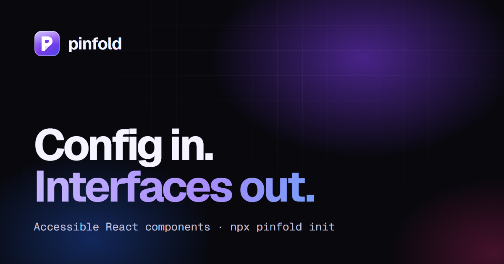

<p align="center">
  <a href="https://pinfold.indranildev.in">
    
  </a>
</p>

<p align="center">
  <strong>The typed React component library driven by a single config object.</strong><br />
  Fully accessible &bull; Endlessly themeable &bull; Baseline 2023 &bull; Zero runtime dependencies
</p>

<p align="center">
  <a href="https://www.npmjs.com/package/@pinfold/react"></a>
  <a href="LICENSE"></a>
  <a href="https://www.npmjs.com/package/@pinfold/react"></a>
  <a href="docs/a11y/screen-readers.md"></a>
  <a href="packages/react/package.json"></a>
</p>

<p align="center">
  <a href="https://pinfold.indranildev.in/docs"><strong>Documentation</strong></a> &nbsp;&bull;&nbsp;
  <a href="https://pinfold.indranildev.in/docs/table"><strong>Components</strong></a> &nbsp;&bull;&nbsp;
  <a href="https://pinfold.indranildev.in/docs/theming"><strong>Theming</strong></a> &nbsp;&bull;&nbsp;
  <a href="https://pinfold.indranildev.in/docs/ai"><strong>AI & MCP</strong></a> &nbsp;&bull;&nbsp;
  <a href="https://github.com/IndranilBhattacharya/pinfold"><strong>GitHub</strong></a>
</p>

<br />

## In 30 seconds

```bash
npx pinfold init          # detects Next.js, Vite or React Router, TypeScript or JavaScript, Tailwind
npx pinfold add table     # one small file you own, plus every stylesheet it needs
```

```tsx
import { defineTable } from '@pinfold/react/table';

// Define the look once, outside your components. It works in Server Components too.
export const Orders = defineTable({ sortable: true, filterable: true, toolbar: true });

export function OrdersPage({ orders }: { orders: Order[] }) {
  return <Orders label="Orders" rows={orders} pageSize={25} />;
}
```

That is a complete data grid with sorting, filters, quick search, column visibility, pagination, keyboard navigation, and verified ARIA attributes. The configuration is statically typed against your row schema, so an invalid column accessor is caught at compile time.

## Why Pinfold

| Capability | Enterprise Advantage |
| :--- | :--- |
| **Write Less** | Components are declared as structured data configurations rather than complex nested JSX trees. Dramatically cleaner diffs and zero agent hallucinations. |
| **Accessible with Proof** | Strict WAI-ARIA compliance verified with axe on every build across all style packs, light and dark. Full keyboard navigation, roving tabindex, contrast safety, and reduced motion. |
| **Never Boxed In** | Semantic slot architecture. Attach custom class names, merge props, or render custom slots. Headless hooks provide full imperative state control with zero markup. |
| **Color Science** | Perceptually uniform OKLCH palette engine with 11 steps per role. Automatically ensures WCAG AA text contrast on every background fill. |
| **Server Components Ready** | `define<Name>()` presets evaluate outside component render cycles and execute seamlessly in React Server Components without hydration overhead. |
| **Zero Runtime Dependencies** | Modular architecture with one subpath and one stylesheet per component. Standard CSS cascade layers (`@layer pinfold.*`) ensure consumer styles and Tailwind utilities always win. |

## Three ways to use a component

```tsx
// 1. A preset (the default): one look, used anywhere, Server Components included
export const Danger = defineButton({ variant: 'soft', tone: 'danger' });
{rows.map((r) => <Danger key={r.id} label="Delete" onClick={() => remove(r.id)} />)}

// 2. A hook, in a client component: the component and its controller
const Faq = useAccordion({ items, mode: 'multiple' });
<button onClick={Faq.openAll}>Expand all</button>
<Faq />

// 3. Your own markup: prop getters with every ARIA attribute
<div {...Faq.getRootProps()}>…</div>
```

Precedence for every option: props &gt; preset &gt; `defaults` in your config &gt; provider &gt; library default.

## Components

Pinfold provides **51 accessible components**, each with a live playground, complete API specification, keyboard navigation map, and verified ARIA patterns on the [interactive documentation site](https://pinfold.indranildev.in/docs) and in [`docs/components`](docs/components).

| Category | Components | Count |
| :--- | :--- | :---: |
| **Layout** | [`App shell`](https://pinfold.indranildev.in/docs/appshell) &bull; [`Navbar`](https://pinfold.indranildev.in/docs/navbar) &bull; [`Sidebar`](https://pinfold.indranildev.in/docs/sidebar) &bull; [`Navigation menu`](https://pinfold.indranildev.in/docs/navmenu) &bull; [`Tabs`](https://pinfold.indranildev.in/docs/tabs) &bull; [`Breadcrumb`](https://pinfold.indranildev.in/docs/breadcrumb) &bull; [`Pagination`](https://pinfold.indranildev.in/docs/pagination) &bull; [`Stepper`](https://pinfold.indranildev.in/docs/stepper) &bull; [`Resizable`](https://pinfold.indranildev.in/docs/resizable) &bull; [`Scroll area`](https://pinfold.indranildev.in/docs/scrollarea) | 10 |
| **Data display** | [`Table`](https://pinfold.indranildev.in/docs/table) &bull; [`Card`](https://pinfold.indranildev.in/docs/card) &bull; [`Accordion`](https://pinfold.indranildev.in/docs/accordion) &bull; [`Tree view`](https://pinfold.indranildev.in/docs/treeview) &bull; [`Timeline`](https://pinfold.indranildev.in/docs/timeline) &bull; [`Carousel`](https://pinfold.indranildev.in/docs/carousel) &bull; [`Avatar`](https://pinfold.indranildev.in/docs/avatar) &bull; [`Badge`](https://pinfold.indranildev.in/docs/badge) &bull; [`Tag group`](https://pinfold.indranildev.in/docs/tags) &bull; [`Kbd`](https://pinfold.indranildev.in/docs/kbd) &bull; [`Empty`](https://pinfold.indranildev.in/docs/empty) &bull; [`Skeleton`](https://pinfold.indranildev.in/docs/skeleton) | 12 |
| **Forms** | [`Input`](https://pinfold.indranildev.in/docs/input) &bull; [`Number field`](https://pinfold.indranildev.in/docs/number) &bull; [`One-time code`](https://pinfold.indranildev.in/docs/otp) &bull; [`Checkbox`](https://pinfold.indranildev.in/docs/checkbox) &bull; [`Radio group`](https://pinfold.indranildev.in/docs/radio) &bull; [`Switch`](https://pinfold.indranildev.in/docs/switch) &bull; [`Toggle`](https://pinfold.indranildev.in/docs/toggle) &bull; [`Toolbar`](https://pinfold.indranildev.in/docs/toolbar) &bull; [`Slider`](https://pinfold.indranildev.in/docs/slider) &bull; [`Select`](https://pinfold.indranildev.in/docs/select) &bull; [`Combobox`](https://pinfold.indranildev.in/docs/combobox) &bull; [`Calendar`](https://pinfold.indranildev.in/docs/calendar) &bull; [`Date picker`](https://pinfold.indranildev.in/docs/datepicker) &bull; [`Color picker`](https://pinfold.indranildev.in/docs/colorpicker) &bull; [`Rating`](https://pinfold.indranildev.in/docs/rating) &bull; [`File upload`](https://pinfold.indranildev.in/docs/fileupload) | 16 |
| **Overlays** | [`Dialog`](https://pinfold.indranildev.in/docs/dialog) &bull; [`Popover`](https://pinfold.indranildev.in/docs/popover) &bull; [`Tooltip`](https://pinfold.indranildev.in/docs/tooltip) &bull; [`Menu`](https://pinfold.indranildev.in/docs/menu) &bull; [`Command`](https://pinfold.indranildev.in/docs/command) &bull; [`Toast`](https://pinfold.indranildev.in/docs/toast) &bull; [`Tour`](https://pinfold.indranildev.in/docs/tour) | 7 |
| **Feedback & Actions** | [`Alert`](https://pinfold.indranildev.in/docs/alert) &bull; [`Progress`](https://pinfold.indranildev.in/docs/progress) &bull; [`Spinner`](https://pinfold.indranildev.in/docs/spinner) &bull; [`Button`](https://pinfold.indranildev.in/docs/button) &bull; [`Separator`](https://pinfold.indranildev.in/docs/separator) &bull; [`Cursor`](https://pinfold.indranildev.in/docs/cursor) | 6 |

## For coding agents

A local Model Context Protocol (MCP) server answers from the exact version you installed, ensuring coding assistants never hallucinate non-existent props or options:

```bash
claude mcp add pinfold -- npx -y pinfold mcp
```

Built-in MCP tools: `search_components`, `list_components`, `get_component`, `get_schema`, `validate_config`, and `get_install_steps`. `llms.txt`, `llms-full.txt`, and component JSON Schemas ship inside `@pinfold/react` and at [pinfold.indranildev.in/llms.txt](https://pinfold.indranildev.in/llms.txt).

## With shadcn

```json
{ "registries": { "@pinfold": "https://pinfold.indranildev.in/r/{name}.json" } }
```

```bash
npx shadcn@latest add @pinfold/table
```

The registry item provides the component source file, package dependencies, and required stylesheets. `@pinfold/css/shadcn.css` harmonizes shadcn variables with Pinfold design tokens.

## Theming

```bash
npx pinfold theme --primary "#4f46e5" --style glass --radius lg --check
```

Seven semantic roles with eleven steps each generated in OKLCH with sRGB fallbacks and automated WCAG contrast validation. Style packs (`glass`, `material`, `noise`, `brutalist`) restyle surfaces, borders, and elevation across all components simultaneously. Test and preview in the [Palette Studio](https://pinfold.indranildev.in/docs/theming).

## Packages

| Package | Purpose & Scope | Installation | Links |
| :--- | :--- | :--- | :--- |
| [`@pinfold/react`](packages/react) | The 51 accessible components: presets, headless hooks, and tags with individual subpaths. | `npm i @pinfold/react` | [npm Package](https://www.npmjs.com/package/@pinfold/react) &bull; [Documentation](https://pinfold.indranildev.in/docs) |
| [`@pinfold/css`](packages/css) | Tokens, scoped reset, component stylesheets, style packs, and Tailwind / shadcn bridges. | `npm i @pinfold/css` | [npm Package](https://www.npmjs.com/package/@pinfold/css) &bull; [Theming Guide](https://pinfold.indranildev.in/docs/theming) |
| [`@pinfold/core`](packages/core) | Framework-free state logic, metadata, WAI-ARIA roving-focus maps, and OKLCH palette engine. | `npm i @pinfold/core` | [npm Package](https://www.npmjs.com/package/@pinfold/core) &bull; [Theming Engine](https://pinfold.indranildev.in/docs/theming) |
| [`pinfold`](packages/cli) | Developer CLI: project setup (`init`), component scaffolding (`add`), theming (`theme`), health audit (`doctor`), and MCP server (`mcp`). | `npx pinfold` | [npm Package](https://www.npmjs.com/package/pinfold) &bull; [CLI Reference](https://pinfold.indranildev.in/docs/cli) |

*React 18 &amp; 19 &bull; TypeScript 4.7+ or JavaScript &bull; Next.js, Vite, React Router, Remix, Gatsby, Astro &bull; Baseline 2023 browsers.*

## Documentation

| Guide | Scope & Focus |
| :--- | :--- |
| [`ARCHITECTURE.md`](ARCHITECTURE.md) | Component architecture, the three-tier config resolution contract, and design principles. |
| [`docs/components`](docs/components) | Complete specifications, DOM slot anatomies, states, and design tokens for all 51 components. |
| [`docs/COMPATIBILITY.md`](docs/COMPATIBILITY.md) | Framework support (Next.js, Vite, Remix, Astro), bundlers, TypeScript 4.7+, and Baseline 2023. |
| [`docs/a11y/screen-readers.md`](docs/a11y/screen-readers.md) | Accessibility test suites, WCAG 2.2 AA conformance proof, and screen reader verification matrix. |
| [`docs/CLI.md`](docs/CLI.md) &bull; [`docs/DISTRIBUTION.md`](docs/DISTRIBUTION.md) | CLI command reference, registry architecture, packaging, and local MCP server specification. |
| [`CONTRIBUTING.md`](CONTRIBUTING.md) | Development workflow, guidelines, verification scripts, and component checklist. |

## Develop

```bash
npm install
npm run verify    # typecheck, unit tests, build, bundle budgets, published types
```

## License

[MIT](LICENSE) &copy; 2026 Indranil Bhattacharya
