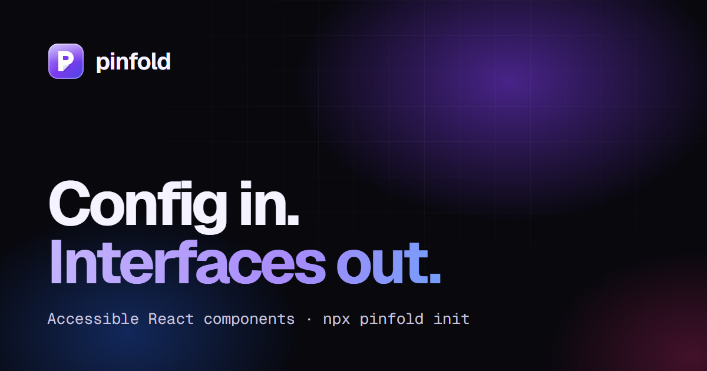

<p align="center">
  <a href="https://pinfold.indranildev.in">
    
  </a>
</p>

<p align="center">
  <strong>The enterprise developer CLI for <a href="https://pinfold.indranildev.in">Pinfold</a></strong><br />
  Project initialization &bull; Component scaffolding &bull; Theme generation &bull; Health audit &bull; Local AI MCP server
</p>

<p align="center">
  <a href="https://www.npmjs.com/package/pinfold"></a>
  <a href="https://github.com/IndranilBhattacharya/pinfold/blob/main/LICENSE"></a>
  <a href="https://www.npmjs.com/package/pinfold"></a>
  <a href="https://www.npmjs.com/package/pinfold"></a>
</p>

<p align="center">
  <a href="https://pinfold.indranildev.in/docs"><strong>Documentation</strong></a> &nbsp;&bull;&nbsp;
  <a href="https://pinfold.indranildev.in/docs/table"><strong>Components</strong></a> &nbsp;&bull;&nbsp;
  <a href="https://pinfold.indranildev.in/docs/ai"><strong>AI & MCP</strong></a> &nbsp;&bull;&nbsp;
  <a href="https://github.com/IndranilBhattacharya/pinfold"><strong>GitHub</strong></a>
</p>

<br />

```bash
npx pinfold init           # language, components folder, theme; asks before writing
npx pinfold add table      # one file you own, plus every stylesheet it needs
```

The CLI inspects your repository before modifying files, generates clean unified diffs, never overwrites existing configurations without confirmation, and is fully idempotent. It uses the package manager discovered in your lockfile and operates completely offline with zero telemetry.

## Commands

| Command | Purpose | Key Flags |
| :--- | :--- | :--- |
| `npx pinfold init` | Detects framework (Next.js App/Pages, Vite, React Router, Remix, Gatsby, Astro), language (TypeScript or JavaScript), and styling (Tailwind v3/v4). Writes `pinfold.config`, CSS imports, and providers. | `--yes`, `--ts`, `--js`, `--dir <folder>`, `--primary <color>`, `--style <pack>`, `--radius <size>`, `--dry-run` |
| `npx pinfold add <name...>` | Scaffolds component files into your project and wires up component stylesheets. Automatically respects configured language and target directory. | `all`, `--dir <folder>`, `--yes`, `--dry-run`, `--no-install` |
| `npx pinfold theme` | Generates OKLCH color palettes with 11 steps per role. Validates contrast against WCAG AA requirements and outputs Tailwind or DTCG tokens. | `--primary <color>`, `--style <pack>`, `--radius <size>`, `--check`, `--format <tailwind\|dtcg>` |
| `npx pinfold doctor` | Diagnoses project health: validates React version, CSS import order, provider setup, Next.js `use client` boundaries, and detects duplicate packages. | `--cwd <dir>` |
| `npx pinfold mcp` | Starts a local Model Context Protocol (MCP) server exposing component schemas and validation tools to AI coding agents (Claude, Cursor, Windsurf). | `--port <num>` |

Pass `--dry-run` to print the configuration diff without writing to disk, or `--no-install` to skip automatic dependency installation.

## Local MCP Server

Provide coding assistants with exact, zero-hallucination component APIs and strict JSON Schema validation:

```bash
claude mcp add pinfold -- npx -y pinfold mcp
```

```json
{
  "mcpServers": {
    "pinfold": {
      "command": "npx",
      "args": ["-y", "pinfold", "mcp"]
    }
  }
}
```

### Available MCP Tools

| Tool | Functionality |
| :--- | :--- |
| `search_components` | Find components by feature keyword, ARIA role, or category. |
| `list_components` | Enumerate all 51 available components with descriptions and subpaths. |
| `get_component` | Retrieve complete component specification, slots, and props. |
| `get_schema` | Get strict JSON Schema for component options validation. |
| `validate_config` | Validate a configuration object against schema and inactive options. |
| `get_install_steps` | Get precise commands and stylesheet imports for a component. |

Everything is served directly from your installed package version, ensuring AI agents never reference unreleased options. Read the [AI & MCP Guide](https://pinfold.indranildev.in/docs/ai) for editor integrations.

---

[MIT](https://github.com/IndranilBhattacharya/pinfold/blob/main/LICENSE) &copy; 2026 Indranil Bhattacharya &bull; [Documentation](https://pinfold.indranildev.in/docs) &bull; [GitHub](https://github.com/IndranilBhattacharya/pinfold)
