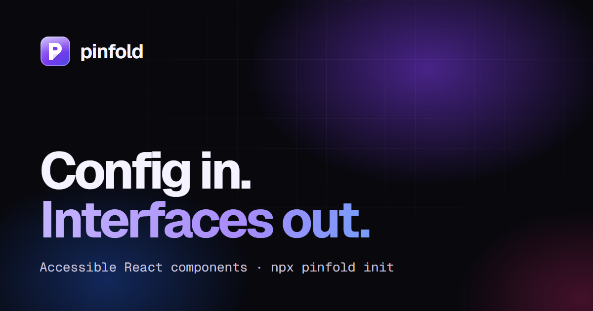

<div align="center">


# @pinfold/core

The framework-free engine of [Pinfold](https://pinfold.indranildev.in): component state logic, design tokens, metadata, and the OKLCH palette system.

[](https://www.npmjs.com/package/@pinfold/core)
[](LICENSE)
[](package.json)

[Documentation](https://pinfold.indranildev.in/docs) · [Theming](https://pinfold.indranildev.in/docs/theming) · [GitHub](https://github.com/IndranilBhattacharya/pinfold)



</div>

No React and no dependencies; a test fails the build if a framework import ever appears here. Most apps never
install it directly, because `@pinfold/react` depends on it. Reach for it to generate a theme, to read component
metadata, or to build an adapter.

## Palette

```ts
import { createTheme, toDTCG } from '@pinfold/core/palette';

const theme = createTheme({ primary: '#4f46e5', neutral: 'slate', danger: 'oklch(0.6 0.22 25)', radius: 'lg' });

theme.vars;              // { '--pinfold-primary-500': '#6170f7', … }
theme.css;               // the stylesheet, light and dark, that `npx pinfold theme` writes
theme.contrast;          // a WCAG report per role and step
theme.anchors.primary;   // { step: 600, color: '#4f46e5' }: your colour sits on its nearest step
toDTCG(theme);           // W3C design tokens for Tokens Studio or Style Dictionary
```

Seven roles (`primary`, `accent`, `neutral`, `success`, `warning`, `danger`, `info`), eleven steps each, gamut
mapped, with sRGB fallbacks. A role takes a hue name (`emerald`), an angle (`262`) or any CSS colour: `#hex`,
`rgb()`, `hsl()`, `oklch()`.

- Text on solid fills is white or near black, whichever reads better. A fill where even the better one is under
  5:1 moves darker or lighter until it reaches 5:1, so a yellow or neon brand keeps readable buttons.
- `success`, `warning`, `danger` and `info` reach every component's tones once set; unset, they keep tuned defaults.

## Metadata

```ts
import { componentMetas, validateConfig, toJsonSchema, metaToMarkdown } from '@pinfold/core/meta';
```

Every component's options with their types and defaults, its parts, keyboard map and ARIA rules. The docs, the
playgrounds, the CLI, the MCP server, the JSON Schemas and dev-time validation are all generated from it. It is
loaded only in development, so apps never ship it.

## Helpers

`cn`, `mergeProps` and `composeRefs` (handlers chain, styles merge), `variants` (class resolution by variant),
`nextIndexFromKey` (the WAI-ARIA roving-focus key map, RTL aware), `dimensionVars`, and each component's rules as
pure functions, for anyone writing an adapter for another framework.

MIT © Indranil Bhattacharya · [Docs](https://pinfold.indranildev.in/docs) · [GitHub](https://github.com/IndranilBhattacharya/pinfold)
