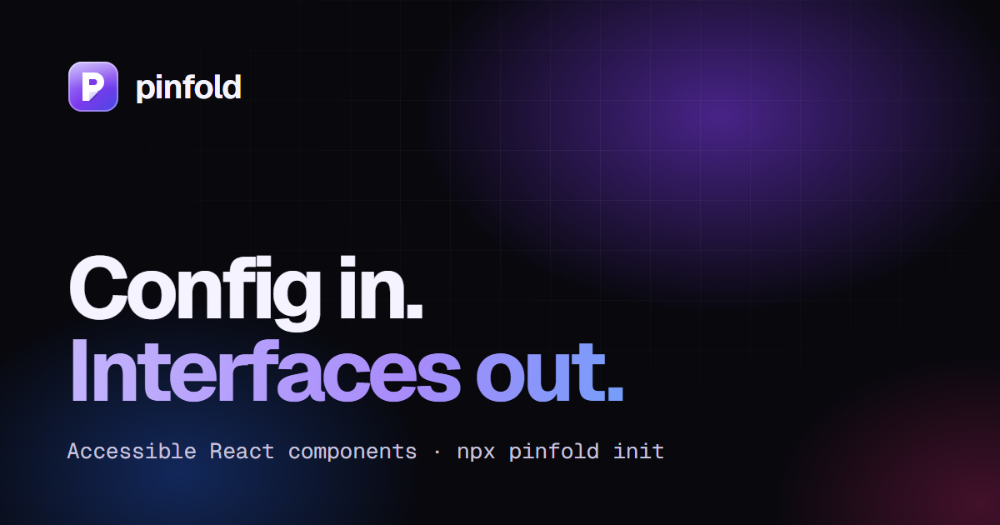

<a href="https://pinfold.indranildev.in">
  
</a>

The typed React component library driven by a single config object. Fully accessible, endlessly themeable, zero friction.

[](https://www.npmjs.com/package/@pinfold/react)
[](https://github.com/IndranilBhattacharya/pinfold/blob/main/LICENSE)
[](https://www.npmjs.com/package/@pinfold/react)
[](https://github.com/IndranilBhattacharya/pinfold/blob/main/docs/a11y/screen-readers.md)
[](https://www.npmjs.com/package/@pinfold/react)

[**Documentation**](https://pinfold.indranildev.in/docs) &nbsp;&bull;&nbsp;
[**Components**](https://pinfold.indranildev.in/docs/table) &nbsp;&bull;&nbsp;
[**Theming**](https://pinfold.indranildev.in/docs/theming) &nbsp;&bull;&nbsp;
[**AI & MCP**](https://pinfold.indranildev.in/docs/ai) &nbsp;&bull;&nbsp;
[**GitHub**](https://github.com/IndranilBhattacharya/pinfold)

---

51 accessible components, from a button to a high-performance data grid that virtualizes a billion rows. Every component implements verified WAI-ARIA patterns, supports keyboard navigation, and passes automated axe tests on every commit. One dedicated subpath per component ensures zero bundle bloat.

## Quickstart

```bash
npx pinfold init        # automated setup with environment detection
# or manual installation:
npm install @pinfold/react @pinfold/css
```

Import required stylesheets in your application root:

```ts
import '@pinfold/css/core.css';
import '@pinfold/css/table.css';
```

## Component Usage Paradigms

```tsx
import { defineTable } from '@pinfold/react/table';

// 1. Preset (Recommended): define look once outside components. Server Components ready.
export const Orders = defineTable({ sortable: true, filterable: true, toolbar: true });

export function OrdersPage({ orders }: { orders: Order[] }) {
  return <Orders label="Orders" rows={orders} pageSize={25} />;
}
```

| Pattern | API Signature | Primary Use Case | Server Components |
| :--- | :--- | :--- | :---: |
| **Preset (Default)** | `define<Name>(config)` | Shared design system presets, loops, static pages | Yes |
| **Headless Hook** | `use<Name>(config)` | Interactive views needing imperative controller APIs (e.g. `openAll`, `downloadCsv`) | Client only |
| **Direct Tag** | `<Name {...config} />` | Isolated, one-off component instances | Yes |

## Slot Customization

Every DOM slot has a semantic identifier. Customize classes, merge props, or render custom nodes without compromising accessibility or keyboard roving:

```tsx
<Faq
  classNames={{ trigger: 'px-6 text-base font-medium' }}
  slotProps={{ panel: { 'data-analytics': 'faq-expanded' } }}
  render={{ indicator: ({ item }) => (item.open ? <Minus /> : <Plus />) }}
/>
```

## Global Provider (Optional)

```tsx
import { PinfoldProvider } from '@pinfold/react';
import '@pinfold/css/packs.css';

<PinfoldProvider theme="system" stylePack="glass" navigate={router.push}>
  {children}
</PinfoldProvider>
```

Resolution precedence for every option: **props** &gt; **preset** &gt; **`defaults` in config** &gt; **provider** &gt; **library default**.

## Components

| Category | Components | Count |
| :--- | :--- | :---: |
| **Layout** | [`App shell`](https://pinfold.indranildev.in/docs/appshell) &bull; [`Navbar`](https://pinfold.indranildev.in/docs/navbar) &bull; [`Sidebar`](https://pinfold.indranildev.in/docs/sidebar) &bull; [`Navigation menu`](https://pinfold.indranildev.in/docs/navmenu) &bull; [`Tabs`](https://pinfold.indranildev.in/docs/tabs) &bull; [`Breadcrumb`](https://pinfold.indranildev.in/docs/breadcrumb) &bull; [`Pagination`](https://pinfold.indranildev.in/docs/pagination) &bull; [`Stepper`](https://pinfold.indranildev.in/docs/stepper) &bull; [`Resizable`](https://pinfold.indranildev.in/docs/resizable) &bull; [`Scroll area`](https://pinfold.indranildev.in/docs/scrollarea) | 10 |
| **Data display** | [`Table`](https://pinfold.indranildev.in/docs/table) &bull; [`Card`](https://pinfold.indranildev.in/docs/card) &bull; [`Accordion`](https://pinfold.indranildev.in/docs/accordion) &bull; [`Tree view`](https://pinfold.indranildev.in/docs/treeview) &bull; [`Timeline`](https://pinfold.indranildev.in/docs/timeline) &bull; [`Carousel`](https://pinfold.indranildev.in/docs/carousel) &bull; [`Avatar`](https://pinfold.indranildev.in/docs/avatar) &bull; [`Badge`](https://pinfold.indranildev.in/docs/badge) &bull; [`Tag group`](https://pinfold.indranildev.in/docs/tags) &bull; [`Kbd`](https://pinfold.indranildev.in/docs/kbd) &bull; [`Empty`](https://pinfold.indranildev.in/docs/empty) &bull; [`Skeleton`](https://pinfold.indranildev.in/docs/skeleton) | 12 |
| **Forms** | [`Input`](https://pinfold.indranildev.in/docs/input) &bull; [`Number field`](https://pinfold.indranildev.in/docs/number) &bull; [`One-time code`](https://pinfold.indranildev.in/docs/otp) &bull; [`Checkbox`](https://pinfold.indranildev.in/docs/checkbox) &bull; [`Radio group`](https://pinfold.indranildev.in/docs/radio) &bull; [`Switch`](https://pinfold.indranildev.in/docs/switch) &bull; [`Toggle`](https://pinfold.indranildev.in/docs/toggle) &bull; [`Toolbar`](https://pinfold.indranildev.in/docs/toolbar) &bull; [`Slider`](https://pinfold.indranildev.in/docs/slider) &bull; [`Select`](https://pinfold.indranildev.in/docs/select) &bull; [`Combobox`](https://pinfold.indranildev.in/docs/combobox) &bull; [`Calendar`](https://pinfold.indranildev.in/docs/calendar) &bull; [`Date picker`](https://pinfold.indranildev.in/docs/datepicker) &bull; [`Color picker`](https://pinfold.indranildev.in/docs/colorpicker) &bull; [`Rating`](https://pinfold.indranildev.in/docs/rating) &bull; [`File upload`](https://pinfold.indranildev.in/docs/fileupload) | 16 |
| **Overlays** | [`Dialog`](https://pinfold.indranildev.in/docs/dialog) &bull; [`Popover`](https://pinfold.indranildev.in/docs/popover) &bull; [`Tooltip`](https://pinfold.indranildev.in/docs/tooltip) &bull; [`Menu`](https://pinfold.indranildev.in/docs/menu) &bull; [`Command`](https://pinfold.indranildev.in/docs/command) &bull; [`Toast`](https://pinfold.indranildev.in/docs/toast) &bull; [`Tour`](https://pinfold.indranildev.in/docs/tour) | 7 |
| **Feedback & Actions** | [`Alert`](https://pinfold.indranildev.in/docs/alert) &bull; [`Progress`](https://pinfold.indranildev.in/docs/progress) &bull; [`Spinner`](https://pinfold.indranildev.in/docs/spinner) &bull; [`Button`](https://pinfold.indranildev.in/docs/button) &bull; [`Separator`](https://pinfold.indranildev.in/docs/separator) &bull; [`Cursor`](https://pinfold.indranildev.in/docs/cursor) | 6 |

Import each component directly: `@pinfold/react/<name>` (e.g. `@pinfold/react/datepicker`).

## Ecosystem

| Package | Role & Scope | Installation | Links |
| :--- | :--- | :--- | :--- |
| [`@pinfold/css`](https://www.npmjs.com/package/@pinfold/css) | Design tokens, scoped reset, modular stylesheets, and Tailwind presets | `npm i @pinfold/css` | [npm Package](https://www.npmjs.com/package/@pinfold/css) &bull; [Docs](https://pinfold.indranildev.in/docs/theming) |
| [`@pinfold/core`](https://www.npmjs.com/package/@pinfold/core) | Framework-free logic, metadata, and OKLCH palette engine | `npm i @pinfold/core` | [npm Package](https://www.npmjs.com/package/@pinfold/core) &bull; [Docs](https://pinfold.indranildev.in/docs/theming) |
| [`pinfold`](https://www.npmjs.com/package/pinfold) | Enterprise developer CLI, component registry, and local MCP server | `npx pinfold` | [npm Package](https://www.npmjs.com/package/pinfold) &bull; [Docs](https://pinfold.indranildev.in/docs/cli) |

---

[MIT](https://github.com/IndranilBhattacharya/pinfold/blob/main/LICENSE) &copy; 2026 Indranil Bhattacharya &bull; [Documentation](https://pinfold.indranildev.in/docs) &bull; [GitHub](https://github.com/IndranilBhattacharya/pinfold)
